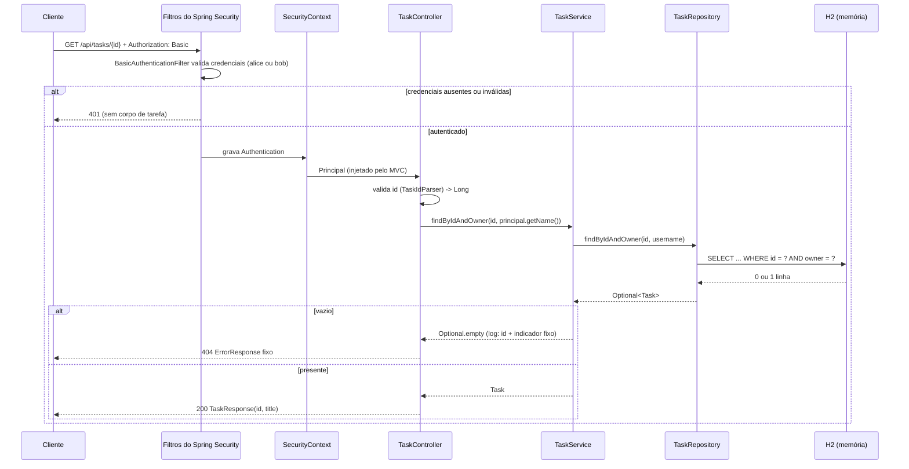
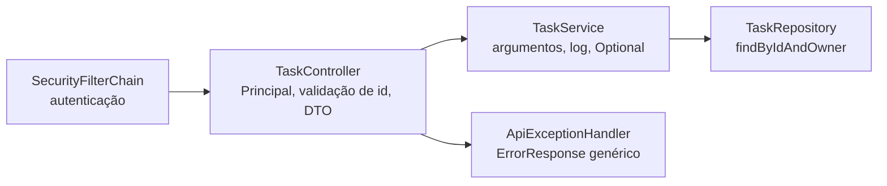

# Design Document

## Overview

Este design corrige a falha BOLA/IDOR (OWASP API1:2023) em `GET /api/tasks/{id}` da API Secure Tasks. Hoje `TaskController.getById` não usa o `Principal` e `TaskService.findByIdVulnerable` chama `repository.findById(id)`. Qualquer usuário autenticado lê a tarefa de outro.

A correção segue quatro decisões:

1. **A identidade vem só do `SecurityContext`.** O controller recebe o `Principal` e passa `principal.getName()` ao service. Nenhum valor de owner do cliente é lido.
2. **A autorização acontece dentro da consulta.** O `TaskRepository` ganha `findByIdAndOwner(Long id, String owner)`. A consulta devolve a tarefa somente se `id` e `owner` coincidem no mesmo registro. O método `findByIdVulnerable` é removido.
3. **Tarefa de outro dono e id inexistente são indistinguíveis.** Os dois casos produzem `Optional.empty()` no service e a mesma resposta 404, com corpo fixo, sem eco de `id`, `path` ou `timestamp`.
4. **Erros e logs não vazam dados.** Um `@RestControllerAdvice` produz corpos de erro genéricos (`ErrorResponse`). Os logs registram apenas o `id` numérico e um indicador fixo.

Fora de escopo: criação, alteração e exclusão de tarefas, troca do mecanismo de autenticação, deploy e acesso a serviços externos. `SecurityConfig`, `application.properties` e `DataSeeder` permanecem como estão.

### Pesquisa e fatos que orientam o design

Verificado no código existente e na documentação do Spring (conhecimento do framework, sem acesso externo nesta fase):

- **O corpo de erro padrão do Spring Boot não é idêntico entre ids.** O `DefaultErrorAttributes` inclui `timestamp` e `path`. O `path` contém o id (`/api/tasks/42` contra `/api/tasks/999999`), o que viola os requisitos 4.2, 6.2 e 12.5. O design substitui o corpo por um handler próprio.
- **A conversão `String -> Long` do Spring é permissiva demais.** `StringToNumberConverterFactory` usa `NumberUtils.parseNumber`, que aceita hexadecimal (`0x1F`), `#1F` e octal (`010`). O requisito 9.3 exige inteiro decimal dentro do intervalo de `Long`. O design recebe o `id` como `String` e o valida com um parser estrito (`TaskIdParser`).
- **`ResponseStatusException` com `reason` ecoa a mensagem no corpo padrão.** O design troca por uma exceção de domínio própria (`TaskNotFoundException`) tratada pelo advice.
- **`open-in-view=false` e `ddl-auto=create-drop`** já estão configurados. Nenhuma mudança é necessária.
- **Conflito entre requisitos tratado aqui.** O requisito 2.6 manda lançar `IllegalArgumentException` para username nulo ou vazio. O requisito 8.5 manda sinalizar ausência de resultado nesse mesmo caso. Decisão: **username nulo ou vazio lança `IllegalArgumentException`** (2.4 e 2.6, regra mais estrita, aplicada a todas as consultas). **`id` nulo retorna `Optional.empty()`** sem consultar o repositório (8.5). Este ponto deve ser confirmado na revisão humana.

## Architecture

### Fluxo de identidade



### Limites de confiança

| Elemento | Origem | Confiança | Tratamento |
|---|---|---|---|
| Username | `SecurityContext` após HTTP Basic | Confiável | Único valor usado como owner nas consultas |
| `id` do caminho | Cliente | Não confiável | Validado por `TaskIdParser` (decimal, intervalo de `Long`); 400 se inválido |
| Query string, cabeçalhos (exceto `Authorization`), corpo | Cliente | Não confiável | Nunca lidos pelo controller; sem `@RequestParam`, `@RequestHeader` ou `@RequestBody` |
| `owner` da tarefa | Banco de dados | Confiável | Usado só no predicado da consulta; nunca serializado |

O limite de autorização está na consulta `findByIdAndOwner`. Mesmo que um futuro chamador do service esqueça uma checagem, o repositório não devolve tarefa alheia.

### Camadas e responsabilidades



### Decisões e justificativas

| Decisão | Alternativa descartada | Motivo |
|---|---|---|
| `findByIdAndOwner` em uma consulta | `findById` e comparar owner no service | Remove a janela entre buscar e autorizar e reduz o risco de esquecer a checagem (req. 8.1) |
| 404 para tarefa de outro dono | 403 | 403 revela que a tarefa existe (req. 1.5, 4.1) |
| `ErrorResponse` fixo no advice | Corpo padrão do Spring Boot | O padrão inclui `path` e `timestamp`, que diferem entre requisições |
| Parser estrito de `id` | `@PathVariable Long` | O conversor do Spring aceita hexadecimal e octal |
| Sem alteração em `SecurityConfig` | Ajustar a chain | O 401 do HTTP Basic já atende 5.1 a 5.4 e 11.4; o requisito 13 exige revisão para mexer em segurança |

## Components and Interfaces

### `TaskRepository` (alterado)

```java
public interface TaskRepository extends JpaRepository<Task, Long> {
    List<Task> findByOwner(String owner);
    Optional<Task> findByIdAndOwner(Long id, String owner);   // novo
}
```

A consulta derivada gera `WHERE id = ? AND owner = ?` com parâmetros vinculados (sem concatenação de strings). A comparação de `owner` é exata. Conferir no teste de repositório que o H2 não aplica comparação case-insensitive; o requisito 1.2 exige sensibilidade a maiúsculas e minúsculas.

### `TaskService` (alterado)

```java
public List<Task> listByOwner(String username);                      // valida username
public Optional<Task> findByIdAndOwner(Long id, String username);   // substitui findByIdVulnerable
```

Regras:

- `username == null` ou em branco: `IllegalArgumentException` com mensagem genérica, sem consultar o repositório (2.4, 2.6). Vale para as duas operações.
- `id == null`: `Optional.empty()` sem consultar o repositório (8.5).
- Caso comum: delega a `repository.findByIdAndOwner(id, username)` e devolve o resultado.
- Resultado vazio: um único log `INFO` com o texto fixo `tarefa nao encontrada` e o `id`. Sem username, owner real, título nem cabeçalhos (6.4, 10.2). O mesmo log vale para id inexistente e tarefa de outro dono, então o resultado observável é o mesmo.
- `findByIdVulnerable` é removido, junto com os comentários que o descrevem (8.3).

### `TaskController` (alterado)

```java
@GetMapping
public List<TaskResponse> list(Principal principal);

@GetMapping("/{id}")
public TaskResponse getById(@PathVariable("id") String rawId, Principal principal);
```

- Os dois métodos obtêm o username de `principal.getName()`. Se `principal == null`, lançam `AuthenticationCredentialsNotFoundException` antes de chamar o service (2.5). Com `anyRequest().authenticated()` esse ramo é inalcançável em execução normal e funciona como defesa em profundidade.
- `getById` converte `rawId` com `TaskIdParser.parse`. Valor inválido lança `InvalidTaskIdException` (400).
- `getById` chama `service.findByIdAndOwner(id, username)` com exatamente esses dois valores (2.3). Resultado vazio lança `TaskNotFoundException` (404).
- O tipo de retorno é sempre `TaskResponse` ou `List<TaskResponse>` (9.2). A entidade `Task` nunca chega à serialização.
- Nenhum `@RequestParam`, `@RequestHeader` ou `@RequestBody`. Owner enviado pelo cliente não é lido, então o resultado é idêntico ao de uma requisição sem esse valor (1.7, 2.2, 3.4).

### `TaskIdParser` (novo, pacote `web`)

```java
final class TaskIdParser {
    static long parse(String raw);   // lança InvalidTaskIdException
}
```

Aceita somente `^-?[0-9]+$` com `Long.parseLong` sem estouro. Rejeita vazio, decimal (`1.5`), hexadecimal, octal com prefixo, `+`, espaços, texto e valores acima de `9223372036854775807`. Função pura, sem I/O.

Um `id` negativo ou zero é decimal válido e resulta em 404 (não existe), não em 400.

### `ApiExceptionHandler` (novo, `@RestControllerAdvice`, pacote `web`)

| Exceção | Status | Corpo |
|---|---|---|
| `TaskNotFoundException` | 404 | `ErrorResponse("NOT_FOUND", "Tarefa não encontrada")` |
| `InvalidTaskIdException` | 400 | `ErrorResponse("BAD_REQUEST", "Requisição inválida")` |
| `AuthenticationCredentialsNotFoundException` | 401 | sem corpo |
| `IllegalArgumentException` | 400 | `ErrorResponse("BAD_REQUEST", "Requisição inválida")` |
| `Exception` (demais) | 500 | `ErrorResponse("INTERNAL_ERROR", "Erro interno")` |

O 401 gerado pelo HTTP Basic fora do controller continua vindo do `BasicAuthenticationEntryPoint` e não passa pelo advice. O handler genérico registra apenas o nome do tipo da exceção, nunca a mensagem nem o stack trace do pedido do cliente.

### `SecurityConfig`, `application.properties`, `DataSeeder` (sem alteração)

- `SecurityConfig`: HTTP Basic, `anyRequest().authenticated()`, CSRF padrão habilitado, usuários `alice` e `bob`.
- `application.properties`: sem novas chaves. Não se adiciona logging de `Authorization`, de SQL com parâmetros nem de `DEBUG` do Spring Security. Os níveis de log padrão atendem ao requisito 10.
- `DataSeeder`: continua criando as tarefas 42 (alice) e 43 (bob).

### Dependências de teste (alteração em `pom.xml`, requer aprovação)

Para as propriedades: `net.jqwik:jqwik` e `net.jqwik:jqwik-spring`, ambas com escopo `test`. É uma mudança em arquivo de build ligada a testes de autorização, então segue o requisito 13.1 (aprovação humana antes de aplicar). O download delas pelo Maven é acesso a um repositório externo, então o comando de build deve ser apresentado e aprovado (13.4) e só deve rodar se o repositório local já tiver os artefatos ou se o revisor autorizar.

## Data Models

### Entidade `Task` (inalterada)

| Campo | Tipo | Observação |
|---|---|---|
| `id` | `Long` | Atribuído manualmente (sem geração) |
| `title` | `String` | Fictício |
| `owner` | `String` | Username; definido pelo servidor (seed); sem setter e sem mapeamento de entrada |

### DTO `TaskResponse` (inalterado)

`record TaskResponse(Long id, String title)`. Serializa exatamente `id` e `title`, sem `owner`.

### DTO `ErrorResponse` (novo, pacote `dto`)

`record ErrorResponse(String code, String message)`. Os valores vêm de constantes fixas. Nenhum campo é preenchido com dado da requisição (id, path, username) ou da tarefa.

### Exceções de domínio (novas)

- `TaskNotFoundException` (sem mensagem dinâmica).
- `InvalidTaskIdException` (sem o valor recebido na mensagem).

### Dados de teste

Apenas as tarefas fictícias 42 e 43 do seeder e tarefas fictícias geradas nos testes. Nenhum dado real ou PII.

## Correctness Properties

*A property is a characteristic or behavior that should hold true across all valid executions of a system-essentially, a formal statement about what the system should do. Properties serve as the bridge between human-readable specifications and machine-verifiable correctness guarantees.*

Nos testes, "usuário" é um username gerado (inclui `alice`, `bob`, variações de maiúsculas e minúsculas e nomes aleatórios fictícios), e "tarefa" é uma `Task` fictícia com `id`, `title` e `owner` gerados.

### Property 1: Acesso por id somente para o proprietário exato

*For any* conjunto de tarefas persistidas, qualquer `id` e qualquer username não vazio, `TaskService.findByIdAndOwner(id, username)` retorna a tarefa se e somente se existe uma tarefa com esse `id` cujo `owner` é igual ao username por comparação exata (sensível a maiúsculas e minúsculas). Em todos os outros casos retorna `Optional.empty()`, sem distinguir `id` inexistente de tarefa de outro dono.

**Validates: Requirements 1.2, 3.1, 8.1, 8.4**

### Property 2: Respostas de não proprietário e de id inexistente são indistinguíveis

*For any* tarefa de um usuário B, qualquer `id` inexistente e qualquer usuário autenticado A diferente de B, a resposta de `GET /api/tasks/{id}` para a tarefa de B e a resposta para o `id` inexistente têm o mesmo status (404), o mesmo conjunto de cabeçalhos (exceto data/hora) e o mesmo corpo byte a byte. O corpo não contém `id`, `title`, `owner` nem valores derivados da tarefa, e nenhuma tarefa é alterada.

**Validates: Requirements 1.5, 3.5, 4.1, 4.2, 4.3, 6.1, 6.2, 9.5**

### Property 3: Requisição sem autenticação válida nunca devolve dados

*For any* `id` e qualquer cabeçalho `Authorization` ausente, malformado, com base64 inválido, com usuário desconhecido ou com senha incorreta, `GET /api/tasks/{id}` e `GET /api/tasks` respondem 401 com corpo sem campos de tarefa (`id`, `title`, `owner`) e sem alterar o estado armazenado.

**Validates: Requirements 1.6, 4.4, 5.1, 5.3, 5.4, 11.4, 11.5**

### Property 4: Owner enviado pelo cliente é ignorado

*For any* usuário autenticado, qualquer `id` e qualquer valor de owner, usuário ou identidade enviado em parâmetro de consulta ou cabeçalho, a resposta (status, cabeçalhos exceto data/hora e corpo) é idêntica à da mesma requisição sem esse valor.

**Validates: Requirements 1.7, 2.2, 3.4**

### Property 5: Resposta de sucesso expõe somente id e title

*For any* `Task` persistida e consultada pelo seu proprietário, tanto por `GET /api/tasks/{id}` quanto por `GET /api/tasks`, o JSON de cada item tem exatamente as chaves `id` e `title`, com os valores persistidos, e não contém `owner`.

**Validates: Requirements 1.4, 3.2, 3.3, 7.3, 9.1**

### Property 6: Listagem contém exatamente as tarefas do usuário, sem duplicatas

*For any* conjunto de tarefas com donos variados e qualquer username não vazio, `GET /api/tasks` retorna status 200 e uma lista cujos `id`s são exatamente os `id`s das tarefas desse username, sem repetição, e lista vazia se o usuário não possui tarefas.

**Validates: Requirements 1.3, 7.1, 7.2, 7.5**

### Property 7: O parser de id aceita somente inteiros decimais dentro do intervalo de Long

*For any* string, `TaskIdParser.parse` retorna o valor numérico quando a string é um inteiro decimal (`-?[0-9]+`) cujo valor está dentro do intervalo de `Long`, e lança `InvalidTaskIdException` em qualquer outro caso (vazio, espaços, decimal, hexadecimal, octal com prefixo, sinal `+`, texto, overflow).

**Validates: Requirements 9.3, 9.4**

### Property 8: Id inválido gera 400 genérico sem eco

*For any* string de `id` rejeitada pelo parser, `GET /api/tasks/{id}` com usuário autenticado responde 400 com corpo constante, que não contém o valor recebido, nomes de classes, stack trace nem dados de tarefa, e o repositório não é consultado.

**Validates: Requirements 6.3, 9.4, 9.5**

### Property 9: Username inválido é rejeitado antes de consultar o repositório

*For any* username nulo, vazio ou formado só por espaços e qualquer `id`, as operações de consulta do `TaskService` lançam `IllegalArgumentException` sem interagir com o `TaskRepository`.

**Validates: Requirements 2.4, 2.6**

## Error Handling

| Situação | Origem | Status | Corpo | Log |
|---|---|---|---|---|
| Sem credenciais, credenciais malformadas ou inválidas | `BasicAuthenticationFilter` e entry point | 401 | Sem campos de tarefa | Nenhum valor do cabeçalho nem username informado |
| `id` inválido (não decimal, fora do intervalo, vazio de forma alcançável) | `TaskIdParser` e `ApiExceptionHandler` | 400 | `ErrorResponse` constante | Sem o valor recebido |
| Tarefa de outro dono ou `id` inexistente | `TaskService` vazio e `TaskNotFoundException` | 404 | `ErrorResponse` constante, idêntico nos dois casos | Uma entrada: `tarefa nao encontrada` e `id` |
| Username nulo ou vazio no service | `IllegalArgumentException` | 400 | `ErrorResponse` constante | Sem dados |
| `Principal` ausente no controller | `AuthenticationCredentialsNotFoundException` | 401 | Vazio | Sem dados |
| Falha inesperada | Handler genérico | 500 | `ErrorResponse("INTERNAL_ERROR", "Erro interno")` | Somente o tipo da exceção |

Princípios:

- Todo corpo de erro vem de constantes. Nenhum campo é preenchido com `id`, `path`, `timestamp`, username, título ou owner.
- O 404 nunca usa `ResponseStatusException` com `reason` e não usa o `/error` padrão do Spring Boot, porque esse corpo traz `path` e `timestamp`.
- Os mesmos cabeçalhos de resposta valem para 404 de tarefa alheia e de id inexistente, porque os dois seguem o mesmo caminho de código (`TaskNotFoundException`).
- Falhas de autenticação continuam com o comportamento atual do `SecurityConfig`. Não há alteração nessa classe.
- Um `id` vazio (`/api/tasks/`) é resolvido pelo roteamento como `GET /api/tasks` e não chega ao parser. Esse comportamento é do Spring MVC e não vaza dados.

Logging:

- Permitido: texto fixo `tarefa nao encontrada`, `id` numérico (já validado como `long`, o que impede injeção de linha de log) e o nome do tipo de exceção.
- Proibido: valor de `Authorization`, senhas, username informado pelo cliente, título e owner de tarefas, corpo de requisição.
- Não habilitar `logging.level` de `DEBUG` ou `TRACE` para Spring Security nem para SQL com parâmetros em `application.properties`.

## Testing Strategy

PBT se aplica à lógica de autorização do service, ao parser de id e às invariantes das respostas HTTP, que variam com a entrada e rodam em memória a baixo custo. PBT não se aplica a `SecurityConfig` (configuração), ao `DataSeeder` (efeito colateral simples) nem às checagens estruturais (ausência de `findByIdVulnerable`, tipos de retorno). Esses itens usam testes de exemplo e de fumaça.

### Abordagem dupla

- **Testes de propriedade** (jqwik, com `jqwik-spring` para os que usam o contexto): uma propriedade de corretude é implementada por **um** teste de propriedade, com **no mínimo 100 iterações** (`@Property(tries = 100)` ou superior). Não se implementa PBT do zero.
- **Testes de exemplo e de integração** (JUnit 5, MockMvc, `spring-security-test`, Mockito, `@DataJpaTest`): cenários concretos e casos de borda.
- Cada teste de propriedade leva um comentário com a tag: `Feature: secure-task-access, Property {n}: {texto da propriedade}`.

### Mapeamento das propriedades

| Propriedade | Nível | Geradores |
|---|---|---|
| 1 | `TaskService` com H2 real (`@DataJpaTest` ou `@JqwikSpringSupport`) | Owners e usernames fictícios, com variações de caixa, ids `long` |
| 2 | MockMvc com contexto completo | Usuários A e B, ids existentes e inexistentes |
| 3 | MockMvc | Cabeçalhos `Authorization` aleatórios (ausente, sem prefixo `Basic`, base64 inválido, usuário desconhecido, senha errada) |
| 4 | MockMvc | Nomes aleatórios em query string e cabeçalhos (`X-Owner`, `owner`, `user`) |
| 5 e 6 | MockMvc | Conjuntos de tarefas fictícias com títulos únicos |
| 7 | Unidade (pura) | `String` arbitrárias mais geradores dirigidos (hex, octal, overflow); oráculo com regex e `BigInteger` |
| 8 | MockMvc | Mesmos geradores de inválidos da propriedade 7; asserção de que o corpo não contém o valor enviado |
| 9 | Unidade com `TaskRepository` mockado | `null`, vazio e strings só de espaços |

Observação: os testes de propriedade que gravam tarefas devem limpar os dados entre iterações e não alterar as tarefas 42 e 43 do seeder (ou usar ids em faixa separada), para não interferir nos testes de exemplo.

### Testes de exemplo (requisito 12)

1. `alice` lê `/api/tasks/42`: 200, `id` 42, sem `owner` (12.1).
2. `bob` lê `/api/tasks/43`: 200, `id` 43, sem `owner` (12.2).
3. `bob` lê `/api/tasks/42`: 404, corpo sem `id`, `title`, `owner` nem seus valores (12.3).
4. `alice` lê `/api/tasks/43`: 404 com as mesmas verificações (12.4).
5. `bob` lê 42 e depois 999999: mesmo status e mesmo corpo, ignorando cabeçalhos de data (12.5).
6. Sem credenciais, 42 e 999999: 401 sem dados (12.6).
7. `alice` lê 999999: 404 sem dados (12.7).
8. Listagem: `alice` recebe exatamente a tarefa 42 e `bob` exatamente a 43 (12.8).
9. Owner do cliente por query e por cabeçalho: `bob` com `alice` obtém 404 e `alice` com `bob` obtém 200 e id 42 (12.9).
10. Repositório: `findByIdAndOwner` com owner correto, owner errado, owner em outra caixa e id inexistente.
11. Service: (a) dono recebe resultado, (b) outro usuário recebe `Optional.empty()`, (c) id inexistente produz o mesmo resultado que (b) (8.6). Verificação de interação: o service só chama `findByIdAndOwner` e nunca `findById`.
12. Controller com service mockado: o service recebe exatamente `(id, username do Principal)`; `Principal` nulo não chama o service (2.3, 2.5).
13. Logs: com appender de teste, cobrir (a) nenhuma entrada contém senha, valor de `Authorization` ou PII, (b) tarefa não encontrada gera uma entrada com `id` e indicador fixo, sem título nem owner real, e igual para os dois casos, (c) `Authorization` inválido não gera eco do valor nem do usuário (10.1 a 10.3, 10.5).
14. Fumaça: `alice` e `bob` autenticam, terceiro usuário recebe 401; o seeder cria exatamente 2 tarefas (11.1, 11.3). `TaskService` não declara `findByIdVulnerable`. Métodos do controller retornam `TaskResponse` ou `List<TaskResponse>`.

### Regressão do teste de caracterização

`caracterizacao_BOLA_bobAcessaTarefa42DeAlice_retorna200` é substituído por um teste que espera **404** para `bob` lendo a tarefa 42, com o nome sugerido `bobAcessaTarefa42DeAlice_retorna404`. Regras:

- A expectativa original (200) é invertida somente porque o requisito 12.10 o determina. Nenhum outro teste existente é alterado, removido ou tem asserção relaxada.
- Os testes `aliceAcessaPropriaTarefa42_retorna200`, `anonimo_retorna401`, `tarefaInexistente_retorna404` e `listagemRetornaApenasTarefasDoUsuarioAutenticado` permanecem como estão.
- Nenhum teste usa `@Disabled`, `@WithMockUser` para contornar a autenticação, `csrf().disable()`, nem substitui `SecurityFilterChain`. Os testes usam `httpBasic("alice", "alice-demo")` e `httpBasic("bob", "bob-demo")` contra a configuração real.

### Governança e execução

- As alterações em `TaskController`, `TaskService`, `TaskRepository`, `ApiExceptionHandler`, `TaskIdParser`, nos testes de autorização e no `pom.xml` são alterações de segurança. Exigem aprovação humana explícita antes de serem aplicadas (13.1, 13.2).
- Qualquer comando (por exemplo `mvn test`) é apresentado por completo antes de rodar (13.4). Sem deploy e sem acesso externo (13.3, 13.6). Se o repositório Maven local não tiver as dependências do jqwik, o comando acessaria um repositório externo e deve ser rejeitado, a menos que o revisor o autorize.
- Itens de revisão sugeridos: conflito entre 2.6 e 8.5, tratamento de `id` negativo (404, não 400) e inclusão de `jqwik` no `pom.xml`.
